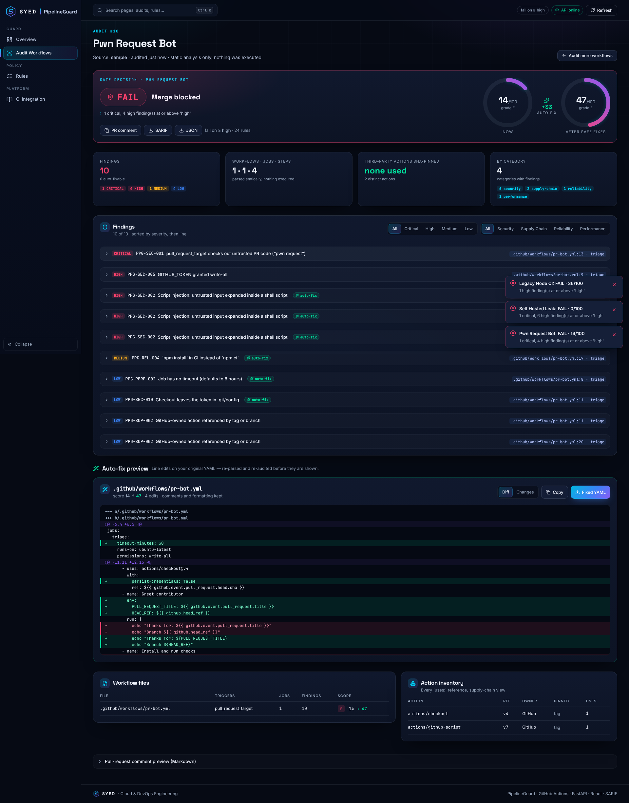

<div align="center">

# SYED PipelineGuard

**Security & performance auditor for GitHub Actions workflows.**
Finds pwn requests, script injection, unpinned actions, leaked secrets and slow, wasteful jobs —
then scores the pipeline, gates the pull request and writes a safe auto-fix you can review as a diff.

`24 rules` · `PASS / WARN / FAIL gate` · `0–100 score` · `auto-fix diff` · `SARIF for code scanning` · `CLI + GitHub Action + dashboard`



</div>

## Why

A CI pipeline is code that runs with your secrets, your cloud credentials and a token that can write to your repo.
Most teams review application code carefully and copy-paste workflow YAML from blog posts.

Real incidents this tool checks for:

- **Pwn requests** — `pull_request_target` + checking out the fork's code = attacker code running with your secrets.
- **Script injection** — `run: echo "${{ github.event.pull_request.title }}"` turns a PR title into shell code.
- **Mutable action tags** — in March 2025 the `tj-actions/changed-files` tags were moved to malicious code and leaked CI secrets from thousands of repositories. Pinning to a commit SHA prevents this.

PipelineGuard catches these **before merge**, explains each finding with a fix and a reference, and fixes the mechanical ones for you.

## What it does

| | |
|---|---|
| **Static analysis** | Parses workflow YAML with line numbers (handles the YAML `on:` → `true` quirk). Nothing is executed. |
| **24 rules, 4 categories** | security · supply-chain · reliability · performance — each with a stable ID, severity, remediation and a public reference. |
| **Gate** | `FAIL` on any finding at/above `--fail-on` (default `high`) or a file that does not parse · `WARN` on medium · `PASS` otherwise. |
| **Score** | Per file: 100 − 25×critical − 12×high − 5×medium − 2×low (floor 0); overall = mean. Grades A ≥ 90 · B ≥ 80 · C ≥ 65 · D ≥ 50 · F. |
| **Auto-fix** | Line edits on the original YAML (comments and formatting survive): least-privilege `permissions`, `concurrency`, `timeout-minutes`, dependency `cache`, `persist-credentials: false`, deprecated major bumps, `set-output` → `$GITHUB_OUTPUT`, `npm install` → `npm ci`, and moving untrusted `${{ }}` input into `env:`. Every fixed file is re-parsed and re-audited before it is shown. |
| **Outputs** | Text, JSON, Markdown (PR comment / job summary), **SARIF 2.1.0** (GitHub code scanning), inline `::error` annotations. |
| **Public repo scan** | Dashboard/API can read `.github/workflows` of any public repo via the GitHub REST API (read-only). |
| **Action inventory** | Every `uses:` reference — owner, ref, SHA-pinned or not. |

## Rules

| ID | Severity | Category | Rule | Auto-fix |
|---|---|---|---|---|
| `PPG-SEC-001` | critical | security | pull_request_target checks out untrusted PR code (“pwn request”) | — |
| `PPG-SEC-002` | high | security | Script injection: untrusted input expanded inside a shell script | ✅ |
| `PPG-SEC-003` | critical | security | Hard-coded credential in workflow file | — |
| `PPG-SEC-004` | high | security | Secret printed to the log | — |
| `PPG-SEC-005` | high | security | GITHUB_TOKEN granted write-all | — |
| `PPG-SEC-006` | medium | security | No explicit token permissions | ✅ |
| `PPG-SEC-007` | high | security | Self-hosted runner exposed to pull requests | — |
| `PPG-SEC-008` | high | security | Remote script piped straight into a shell | — |
| `PPG-SEC-009` | high | security | Insecure workflow commands enabled (set-env / add-path) | — |
| `PPG-SEC-010` | low | security | Checkout leaves the token in .git/config | ✅ |
| `PPG-SEC-011` | medium | security | Reusable workflow receives every secret (`secrets: inherit`) | — |
| `PPG-SUP-001` | high | supply-chain | Third-party action not pinned to a commit SHA | — |
| `PPG-SUP-002` | low | supply-chain | GitHub-owned action referenced by tag or branch | — |
| `PPG-SUP-003` | medium | supply-chain | Container image without a fixed version | — |
| `PPG-SUP-004` | medium | supply-chain | Archived / unmaintained action | — |
| `PPG-REL-001` | medium | reliability | Deprecated action major version | ✅ |
| `PPG-REL-002` | medium | reliability | Deprecated set-output / save-state command | ✅ |
| `PPG-REL-003` | medium | reliability | Quality gate can never fail (continue-on-error) | — |
| `PPG-REL-004` | medium | reliability | `npm install` in CI instead of `npm ci` | ✅ |
| `PPG-PERF-001` | medium | performance | Dependencies downloaded from scratch on every run | ✅ |
| `PPG-PERF-002` | low | performance | Job has no timeout (defaults to 6 hours) | ✅ |
| `PPG-PERF-003` | low | performance | Superseded runs are not cancelled | ✅ |
| `PPG-PERF-004` | low | performance | Full git history cloned (fetch-depth: 0) | — |
| `PPG-PERF-005` | low | performance | Expensive runner type | — |

## Quick start

Requirements: Python 3.12+, Node 22+. No Docker, no cloud account. RAM use is small (FastAPI + SQLite).

```bash
# 1) API (port 8200)
cd backend
python -m venv .venv && source .venv/bin/activate      # Windows: .venv\Scripts\activate
pip install -r requirements-dev.txt
uvicorn pipelineguard.api:app --port 8200

# 2) Dashboard (port 5175) — second terminal
cd frontend
npm ci
npm run dev        # open http://localhost:5175
```

### CLI

```bash
cd backend
python -m pipelineguard ../.github/workflows                         # text report
python -m pipelineguard ../.github/workflows --fail-on medium
python -m pipelineguard ../.github/workflows --format sarif --output pg.sarif
python -m pipelineguard ../.github/workflows --write-fixes fixed/     # auto-fixed copies
python -m pipelineguard pipelineguard/samples/pwn-request-bot --format markdown
```

Exit codes: `0` PASS/WARN · `1` FAIL · `2` invalid input.

### GitHub Action

```yaml
permissions:
  contents: read
  security-events: write        # only for the SARIF upload
jobs:
  audit:
    runs-on: ubuntu-latest
    timeout-minutes: 5
    steps:
      - uses: actions/checkout@v4
        with:
          persist-credentials: false
      - uses: syedshah7214/syed-pipelineguard@main
        with:
          path: .github/workflows
          fail-on: high
          sarif-file: pipelineguard.sarif
      - if: always()
        uses: github/codeql-action/upload-sarif@v3
        with:
          sarif_file: pipelineguard.sarif
```

Outputs: `decision` (PASS/WARN/FAIL) and `score`. For production use, pin the action to a commit SHA.

## API

| Method | Path | |
|---|---|---|
| GET | `/health` | version and rule count |
| GET | `/api/v1/rules` | all rules |
| GET | `/api/v1/samples`, `/api/v1/samples/{name}` | demo workflows |
| POST | `/api/v1/analyze` | `{files:[{path,content}], fail_on}` → report |
| POST | `/api/v1/scan-repo` | `{repo:"owner/repo", ref?}` → report (public repos) |
| GET | `/api/v1/audits`, `/api/v1/audits/{id}` | history (SQLite, last 500) |
| GET | `/api/v1/audits/{id}/markdown`, `/sarif` | exports |
| GET | `/api/v1/stats` | totals for the dashboard |

Interactive docs at `http://localhost:8200/docs`. Limits: 50 files, 500 KB per file. Security headers on every response; an optional server-side `GITHUB_TOKEN` (public read only) raises the GitHub rate limit and is never sent to the browser.

## Architecture

```
.github/workflows/*.yml ──► workflow.py  (YAML + line numbers → Workflow/Job/Step)
                              │
                              ▼
                           rules.py     (24 checks, decorator registry)
                              │
                 ┌────────────┼──────────────┐
                 ▼            ▼              ▼
            analyzer.py   autofix.py     render.py
          (score + gate) (line edits,   (text · markdown · SARIF)
                          re-audited)
                 │
     ┌───────────┼─────────────┐
     ▼           ▼             ▼
   cli.py     api.py        action.yml
 (exit codes) (FastAPI +   (composite action,
              SQLite) ──►   job summary, outputs)
                React dashboard
```

## How this repository tests itself

- **pytest**: 36 engine + API tests (≈95 % coverage, CI gate at 90 %), ruff lint + format.
- **Dogfooding**: the `dogfood` job runs PipelineGuard on this repo's own workflow through `uses: ./` — it must not FAIL. (The first run caught the unpinned `gitleaks-action` in this very CI file; it is now SHA-pinned.)
- The vulnerable samples must FAIL, the hardened sample must PASS, and every auto-fixed sample must still be valid YAML.
- Dashboard: TypeScript strict build + ESLint. Secret scan with gitleaks, `pip-audit`, `npm audit`, Dependabot for actions/pip/npm.

## Honest limits

- Static analysis only: it cannot see repository settings (default token permissions, fork-PR approval rules, branch protection) or what a third-party action does internally.
- It does not resolve tags to SHAs for you — use Dependabot or a pinning tool for that.
- Auto-fix covers mechanical changes; pwn requests, `write-all`, self-hosted runners and secrets in the file need a human decision, so they stay as findings.
- Sample workflows in `backend/pipelineguard/samples/` are hand-written to demonstrate attack patterns. The AWS key in `self-hosted-leak` is fake.

## Project structure

```
backend/pipelineguard/   workflow.py rules.py analyzer.py autofix.py render.py cli.py api.py github_fetch.py samples/
backend/tests/           test_engine.py test_api.py
frontend/src/            pages/ (Overview, Analyze, Report, Rules, CI) components/ lib/
action.yml               composite GitHub Action
.github/workflows/ci.yml engine · dashboard · dogfood · secrets
docs/                    screenshots, Roman Urdu guide
```

## Author

**Syed Masum Ali** — SYED | Cloud & DevOps Engineering · [github.com/syedshah7214](https://github.com/syedshah7214)

MIT License.
